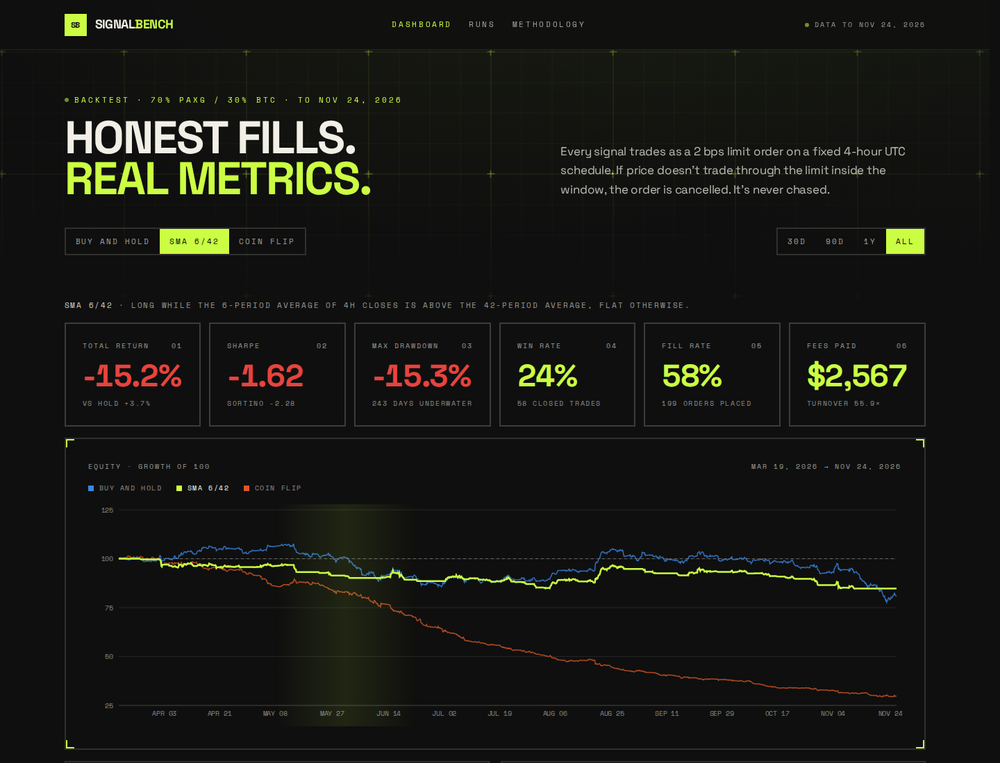

# SignalBench

**Backtest trading signals with honest fills.** Every signal trades as a 2 bps limit order on a fixed 4-hour UTC schedule. If price doesn't trade
_through_ the limit inside the window, the order is cancelled and never chased. The dashboard reports what that does to return, Sharpe, drawdown,
win rate and fill rate for a 70% gold / 30% BTC portfolio.

**Live:** https://signalbench.sholaayeni.xyz



## Why

Most backtests assume you trade at the close. Real limit orders don't always fill, and they tend to fill when price is moving against you. SignalBench
models that explicitly, so a strategy's numbers include the cost of actually getting filled.

One example from the data: PAXG/USD (the gold leg) is thin on Bitstamp. More than half of its 15-minute bars have zero volume (59% when this was written), so the gold sleeve fills far
less often than BTC. A close-price backtest would hide that completely.

## How it works

```
packages/engine   pure TypeScript, no I/O: UTC schedule, limit-order fill model, sleeve accounting, metrics
packages/data     Bitstamp public OHLC client (paging, retries with backoff) + JSON file cache
scripts/          fetch-candles.ts → run-backtests.ts → apps/web/data/*.json
apps/web          Next.js 15 dashboard (standalone build), served from a container
infra/            CloudFormation: ECR, VPC, ACM cert, ECS Fargate + ALB
```

The fill model, per asset and per anchor (00:00, 04:00 … UTC):

1. The **target** is the latest signal with `t <= anchor`, so there's no look-ahead.
2. The **reference** is the last fully closed 15m bar's close.
3. Place a **limit** for the difference between target and position, 2 bps better than the reference.
4. It **fills** on the first bar in `[anchor, anchor + 4h)` whose low is strictly below the limit (high strictly above, for sells). The fill is at the
   limit, all-or-nothing, with a 5 bps fee. Otherwise it's **cancelled**.

Metrics: Sharpe and Sortino on daily returns at 00:00 UTC, annualised with √365 (both markets trade every day). Max drawdown and time underwater come
from 4h equity points. Win rate is over round trips, net of fees. There's also turnover, fill rate and exposure. The engine has a hand-worked golden
test (`packages/engine/test/portfolio.test.ts`).

Baselines ship with it: **buy and hold**, an **SMA 6/42** trend filter on 4h closes and a seeded **coin flip**. The coin flip loses money even with zero
fees, which is the adverse-selection cost of resting limit orders made visible.

## Run it

```sh
nvm use               # Node 22
npm ci
npm run fetch         # 365 days of 15m bars into data/candles (SB_HISTORY_DAYS to change)
npm run backtest      # writes apps/web/data/
npm run dev           # http://localhost:3000
npm run verify        # lint, format, typecheck, tests, production build
```

Or as a container:

```sh
docker build --build-arg COMMIT_SHA=$(git rev-parse HEAD) -t signalbench/web .
docker run --rm -p 3000:3000 signalbench/web
```

## Bring your own signals

Any JSON signal file can run through the same engine through a field mapping. Keep private files under `signals/private/`, which git ignores.

```jsonc
// signals/private/mapping.json
{
  "recordsPath": "data.signals", // omit if the file is a bare array
  "timeField": "time",
  "timeUnit": "iso", // "s" | "ms" | "iso"
  "assetField": "symbol",
  "assetMap": { "XAUUSD": "PAXGUSD", "BTCUSD": "BTCUSD" },
  "sideField": "action", // BUY / SELL / FLAT (case-insensitive), or use "targetField" for a number in [-1, 1]
}
```

```sh
SB_SIGNALS_FILE=signals/private/model.json \
SB_SIGNALS_MAPPING=signals/private/mapping.json \
SB_SIGNALS_NAME="My model" npm run backtest
```

The run shows up on the dashboard next to the baselines.

## Deployment

ECS Fargate (arm64) in eu-north-1 behind an ALB with TLS. GitHub Actions run CI on pull requests, deploy on every push to `main` (with a smoke test
that checks the live `/api/health` reports the new commit) and redeploy nightly with fresh data. See [docs/DEPLOYMENT.md](docs/DEPLOYMENT.md) and the
[ADRs](docs/adr).

## Design

The UI uses the dark, square, single-accent design system from my agentfloor project: Space Grotesk and Space Mono, `#cbfe42` on `#0f0f0f`, corner-bracket
cards, a mono micro-type scale and reduced-motion support. Charts have a keyboard readout and hidden data tables for screen readers.

## Not investment advice

This is an engineering project about measuring signals honestly. Past simulated performance says nothing about future returns.

## License

MIT
